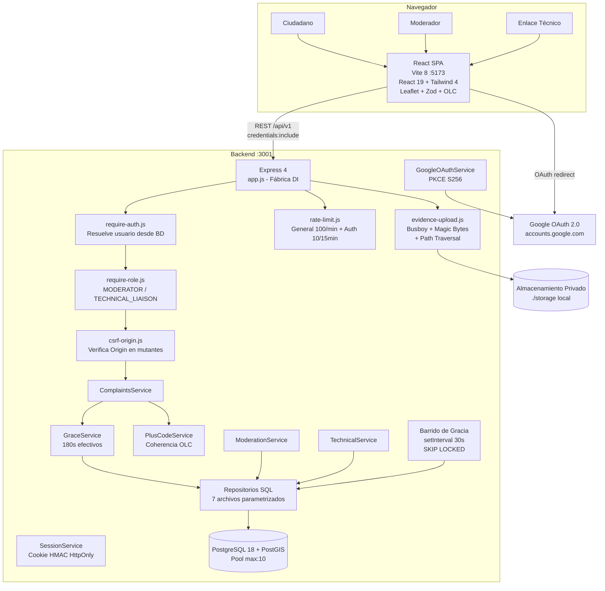

# Informe de Reconocimiento Técnico Integral

## Plataforma Web de Denuncias Ciudadanas — Municipio de Cercado, Cochabamba

**Proyecto:** "Diseño de una Plataforma Web de Denuncias Ciudadanas para la Gestión de Incidencias Urbanas del Municipio de Cercado, Cochabamba"
**Fecha del informe:** 10 de noviembre de 2026
**Tipo de inspección:** Solo lectura (sin modificaciones, sin ejecución de migraciones, sin despliegue)
**Alcance:** Código fuente, esquema SQL, configuración, pruebas y documentación del repositorio `C:\Users\Asus\Documents\proyecto_denuncias`

---

## 1. Resumen Ejecutivo

El proyecto es una aplicación web full-stack con arquitectura cliente-servidor desacoplada que permite a ciudadanos reportar incidencias urbanas (baches, alumbrado, aseo, etc.) y a funcionarios municipales gestionarlas. El backend expone una API REST en Node.js/Express con autenticación OAuth 2.0 de Google (PKCE), 24 tablas en PostgreSQL/PostGIS, control de acceso por roles (RBAC), ventana de gracia de 3 minutos para ediciones, cooldown de 60 minutos, moderación con detección de duplicados geoespacial, atención técnica con soluciones, verificación de soluciones por Moderador, suspensiones de 168 horas y almacenamiento privado de evidencias. El frontend es una SPA React 19 con mapa Leaflet, formulario con Plus Code, contador de gracia en vivo y paneles administrativos. Hay 209 pruebas automatizadas (136 backend + 73 frontend) con reportes de cobertura HTML.

**Estado general:** funcional en entorno de desarrollo local; sin despliegue en producción; sin integración real con Google (las credenciales están vacías en el entorno local); el worker de procesamiento de videos está registrado en BD como tarea `PENDING` pero no existe implementación del procesador.

---

## 2. Identificación y Alcance de lo Inspeccionado

| Aspecto | Detalle |
|---|---|
| Ruta raíz | `C:\Users\Asus\Documents\proyecto_denuncias` |
| Repositorio Git | Sí (carpeta `.git/`) |
| Directorios inspeccionados | `backend/` (43+ archivos src, 14 test), `frontend/` (60+ archivos src, 7 test), `database/` (2 SQL), `docs/` (1 spec, 6 diagramas) |
| Tipo de inspección | Solo lectura; sin ejecución de comandos que modifiquen el proyecto |
| Alcance | Código fuente, esquema SQL, configuración, pruebas, documentación |
| Elementos sensibles | `.env` identificados por su función; valores ocultos |

---

## 3. Árbol de Carpetas y Archivos Relevantes

```text
proyecto_denuncias/
├── backend/                        # API REST Node.js/Express
│   ├── .env / .env.example         # Configuración (DATABASE_URL, SESSION_SECRET, Google OAuth)
│   ├── package.json                # Deps: express, pg, zod, busboy, OLC; devDeps: eslint, c8
│   ├── eslint.config.js            # ESLint 9 flat config
│   ├── storage/                    # Archivos de evidencias (privado, imágenes de prueba)
│   ├── src/
│   │   ├── app.js                  # Fábrica de Express con DI completa
│   │   ├── server.js               # Arranque + barrido de gracia (setInterval 30s)
│   │   ├── config/
│   │   │   ├── env.js              # Carga/valida variables de entorno (fail-fast)
│   │   │   └── database.js         # Pool pg (max:10) + db.transaction()
│   │   ├── routes/                 # 7 routers: health, auth, catalogs, citizens, complaints, moderation, technical
│   │   ├── controllers/            # 6 controllers (capa HTTP → servicio)
│   │   ├── middlewares/            # 8 middlewares
│   │   ├── services/               # 9 servicios de dominio
│   │   ├── repositories/           # 7 repositorios SQL
│   │   ├── validators/             # 6 archivos de schemas Zod
│   │   └── utils/                  # 4 utilidades (errors, logger, asyncHandler, storagePath)
│   ├── tests/                      # 14 archivos (13 test + helpers)
│   └── docs/                       # 5 documentos técnicos internos
│
├── frontend/                       # SPA React 19 + Vite 8
│   ├── .env / .env.example         # VITE_API_URL=http://localhost:3001/api/v1
│   ├── package.json                # Deps: react, leaflet, zod, OLC; devDeps: vitest, tailwind, oxlint
│   ├── vite.config.js              # Plugins react + tailwind + bloque test (vitest)
│   ├── src/
│   │   ├── main.jsx                # BrowserRouter → AuthProvider → App
│   │   ├── App.jsx                 # 10 rutas con guardas de rol (lazy admin pages)
│   │   ├── lib/                    # api.js, constants, pluscode, utils, validation (Zod)
│   │   ├── contexts/               # AuthContext + auth-context
│   │   ├── hooks/                  # useAuth, useGraceTimer
│   │   ├── components/
│   │   │   ├── layout/             # TopBar, Navbar, SidebarDrawer, Footer, PublicLayout
│   │   │   ├── routing/            # RouteGuards
│   │   │   ├── complaints/         # ComplaintForm, LocationPicker, EvidenceUploader, EvidenceUploadPanel, GraceCountdown, StatusBadge
│   │   │   ├── admin/              # AdminMap, ReviewModal, ViolationModal, DuplicateCandidates, SolutionModal
│   │   │   ├── brand/              # MunicipalEmblem, GoogleIcon
│   │   │   └── ui/                 # SectionHeading
│   │   ├── pages/                  # 10 páginas
│   │   └── __tests__/              # 6 suites + setup.js
│   └── public/                     # favicon.svg
│
├── database/
│   ├── 001_initial_schema.sql      # 24 tablas + triggers + índices + extensiones
│   └── 002_seed_catalogs.sql       # 5 categorías, 13 subcategorías, 12 unidades, 20 reglas, 3 roles
│
└── docs/
    ├── 04-especificacion-backend-inicial.md  # Especificación de 6 fases
    ├── 05-reconocimiento-tecnico-integral.md # Este informe
    └── diagrams/                   # 6 archivos PlantUML (.puml)
```

### Función de cada carpeta

- **`backend/`**: API REST. Organizada por capas (config → routes → controllers → services → repositories) con middlewares transversales, validadores Zod y utilidades.
- **`frontend/`**: SPA React. Organizada por dominio (components/layout, complaints, admin, brand, ui), páginas, contexts, hooks y lib de utilidades.
- **`database/`**: Migraciones SQL versionadas (`001` esquema, `002` seeds). Fuente de verdad del modelo de datos.
- **`docs/`**: Documentación de especificación, reconocimiento y diagramas de arquitectura.

### Archivos principales de entrada

- **Backend:** `backend/src/server.js` (arranque) → `backend/src/app.js` (fábrica de Express).
- **Frontend:** `frontend/index.html` → `frontend/src/main.jsx` → `frontend/src/App.jsx` (router).

### Observaciones sobre estructura

- El backend sigue una arquitectura por capas limpia (routes → middlewares → validators → controllers → services → repositories → pg pool).
- Los `.gitkeep` en `repositories/`, `services/`, `validators/` son residuales de la Fase 1; ya no son necesarios.
- `backend/storage/` contiene imágenes de prueba de evidencias que deberían estar en `.gitignore`.
- El documento `04-especificacion-backend-inicial.md` está **duplicado** en `docs/` y `backend/docs/`.
- **No se encontraron:** archivos Docker, configuración de CI/CD, `docker-compose.yml`, ni instrucciones de despliegue en producción.

---

## 4. Tecnologías y Dependencias Verificadas

### Backend (`backend/package.json`)

| Tecnología | Versión declarada | Uso verificado en código | Archivo de evidencia |
|---|---|---|---|
| Node.js | >=20 (engines) | Módulos ES, `node:crypto`, `node:path`, `node:fs` | Todos los `src/**/*.js` |
| Express | ^4.21.2 | Router, middleware chain, `res.cookie()`, `res.redirect()` | `src/app.js`, `src/routes/*.js` |
| pg | ^8.13.1 | Pool (max:10), `pool.query()`, `client.query()` con `$1`-`$n` | `src/config/database.js`, `src/repositories/*.js` |
| Zod | ^3.24.1 | `z.string().trim().min().max()`, `safeParse()`, `error.issues` | `src/validators/*.js` |
| busboy | ^1.6.0 | Streaming multipart, `fileStream.on('limit')`, límites | `src/middlewares/evidence-upload.js` |
| open-location-code | ^1.0.3 | `encode()`, `decode()`, `isFull()`, `isValid()` | `src/services/plus-code.service.js` |
| cookie-parser | ^1.4.7 | `cookieParser(secret)` firma HMAC | `src/app.js` |
| cors | ^2.8.5 | `cors({ origin: FRONTEND_ORIGIN, credentials: true })` | `src/app.js` |
| express-rate-limit | ^7.4.1 | General (100/min) + auth (10/15min) | `src/middlewares/rate-limit.js` |
| dotenv | ^16.4.5 | `dotenv.config()` | `src/config/env.js` |
| eslint | ^9.17.0 (dev) | Flat config | `eslint.config.js` |
| c8 | ^12.0.0 (dev) | Reporter HTML + LCov | script `test:coverage` |

### Frontend (`frontend/package.json`)

| Tecnología | Versión declarada | Uso verificado en código | Archivo de evidencia |
|---|---|---|---|
| React | ^19.2.8 | Hooks, `lazy`, `Suspense` | Todos los `*.jsx` |
| react-dom | ^19.2.8 | `createRoot().render()` | `src/main.jsx` |
| react-router-dom | ^7.18.4 | `BrowserRouter`, `Routes`, `NavLink`, `useNavigate`, `Navigate`, `Outlet` | `src/App.jsx`, `src/pages/*.jsx` |
| leaflet | ^1.9.4 | `L.divIcon()`, `MapContainer`, `Marker`, `TileLayer`, `Popup` | `LocationPicker.jsx`, `AdminMap.jsx` |
| react-leaflet | ^5.0.0 | Componentes React para Leaflet | Mismo archivo |
| lucide-react | ^1.55.0 | Iconos vectoriales | Todos los componentes |
| open-location-code | ^1.0.3 | `encode()` para Plus Code del pin | `src/lib/pluscode.js` |
| Zod | ^4.6.7 | `z.string()`, `z.number()`, `validateSchema()` | `src/lib/validation.js` |
| Tailwind CSS | ^4.3.3 (dev) | Plugin `@tailwindcss/vite`, tokens `@theme` | `vite.config.js`, `src/index.css` |
| vitest | ^5.0.4 (dev) | `describe()`, `it()`, `vi.mock()`, `vi.useFakeTimers()` | `src/__tests__/*` |
| @testing-library/react | ^16.3.3 (dev) | `render()`, `screen.getByText()` | `src/__tests__/*.test.jsx` |
| @testing-library/jest-dom | ^7.0.1 (dev) | `toBeInTheDocument()` | `src/__tests__/setup.js` |
| @vitest/coverage-v8 | ^5.0.4 (dev) | Reporter HTML de cobertura | `vite.config.js` |
| jsdom | ^30.1.2 (dev) | Entorno DOM | `vite.config.js` |
| oxlint | ^1.81.0 (dev) | Linter rápido | script `lint` |

### Clasificación de dependencias

- **Declaradas y usadas efectivamente:** todas las de la tabla anterior.
- **Declaradas, aparentemente no usadas:** `@types/react` y `@types/react-dom` (el proyecto es JavaScript puro, sin TypeScript).
- **Código muerto:** `validateStorageKey()` en `storage-path.js` está exportada pero nunca se invoca (solo se usa `resolveStoragePath()`).
- **Tecnología mencionada pero no verificada:** FFmpeg/Sharp (mencionados en la especificación y en diagramas como parte del pipeline de medios) **no están instalados** ni referenciados en el código.

---

## 5. Arquitectura Real

### Diagrama de Arquitectura Observada



### Detalle de la Arquitectura

1. **Comunicación Frontend → Backend**: El SPA hace `fetch` con `credentials: 'include'` siempre (evidencia: `frontend/src/lib/api.js`). La cookie `denuncias_session` es `HttpOnly`, `SameSite=Lax`, firmada con HMAC-SHA256 vía `cookie-parser`.

2. **Autenticación**: Google OAuth 2.0 Authorization Code con PKCE S256 (`backend/src/services/google-oauth.service.js`). El `state` y `code_verifier` se almacenan en una cookie temporal firmada de 10 minutos (`denuncias_oauth_tx`, `Path=/api/v1/auth`). Tras el callback, el backend crea/encuentra al usuario por `provider_subject` (el `sub` de Google), nunca por correo.

3. **Autorización**: Dos niveles de RBAC (`require-auth.js` + `require-role.js`):
   - `requireAuth` resuelve el usuario completo desde PostgreSQL en cada petición (roles activos con `revoked_at IS NULL`).
   - `requireRole('MODERATOR')` / `requireRole('TECHNICAL_LIAISON')` verifica el rol requerido.

4. **Gestión de errores**: Centralizada en `error-handler.js`. Diferencia `AppError` (operacional, mensaje seguro) de errores inesperados (mensaje genérico). Registra `code`, `name`, `constraint` en logs pero nunca stack traces, SQL ni secretos.

5. **Validación**: Zod en cada capa de entrada. `validateBody(schema)` y `validateQuery(schema)` normalizan y validan antes de llegar al controlador.

6. **Acceso a BD**: Exclusivamente a través de repositorios con consultas parametrizadas (`$1`-`$n`). `db` expone `query()`, `check()`, `transaction()`, `close()`. Transacciones con `BEGIN/COMMIT/ROLLBACK` y `client.release()` en `finally`.

7. **Configuración**: `env.js` carga `dotenv` y valida fail-fast: `DATABASE_URL` y `SESSION_SECRET` obligatorios; en producción también `GOOGLE_CLIENT_ID/SECRET/REDIRECT_URI`. 9 configuraciones opcionales con defaults y rangos.

8. **Integraciones externas**: Google OAuth 2.0 (única integración externa). Almacenamiento de archivos en disco local (`STORAGE_DIRECTORY`).

9. **Diferencia doc vs código**: la especificación menciona un "worker de procesamiento de medios" y almacenamiento tipo S3/R2; el código solo registra tareas `PENDING` en `media_processing_jobs` y usa disco local. Los diagramas PlantUML (`docs/diagrams/`) describen la arquitectura observada, no una aspiracional.

---

## 6. Base de Datos y Relaciones

**Motor:** PostgreSQL 18 con extensiones `pgcrypto` y `postgis` (evidencia: `database/001_initial_schema.sql`).

**24 tablas en 5 grupos funcionales:**

| Grupo | Tablas | Propósito |
|---|---|---|
| **Identidad** | `users`, `auth_identities`, `citizen_profiles`, `admin_profiles` | Cuentas y perfiles; el correo vive solo en `auth_identities.email_private` |
| **Roles/Permisos** | `roles`, `user_roles`, `municipal_units`, `admin_unit_memberships` | RBAC con roles MODERATOR, TECHNICAL_LIAISON, SUPERADMIN |
| **Catálogos** | `categories`, `subcategories`, `assignment_rules` | 5 categorías, 13 subcategorías, 20 reglas de asignación |
| **Denuncias** | `complaints`, `complaint_grace_sessions`, `citizen_submission_limits`, `complaint_status_history`, `complaint_solutions` | Núcleo: `location GEOGRAPHY(POINT,4326)`, 7 estados |
| **Evidencias/Moderación** | `media_assets`, `media_processing_jobs`, `moderation_reviews`, `complaint_assignments`, `complaint_groups`, `complaint_group_members`, `duplicate_proposals`, `violations`, `suspensions` | Evidencias XOR, revisiones, duplicados, infracciones, suspensiones |

### Restricciones críticas verificables

- `complaints`: `CHECK (status = 'GRACE_PERIOD' OR formalized_at IS NOT NULL)`.
- `complaints`: `CHECK (grace_remaining_seconds BETWEEN 0 AND 180)`.
- `suspensions`: `CHECK (ends_at = started_at + INTERVAL '168 hours')` — duración exacta.
- `suspensions`: `UNIQUE (citizen_user_id) WHERE status = 'ACTIVE'` — no superposición.
- `media_assets`: `CHECK` XOR entre `complaint_id` y `solution_id` según `purpose` — separación estructural de evidencias ciudadanas vs técnicas.
- `complaint_assignments`: `UNIQUE (complaint_id) WHERE ended_at IS NULL` — una asignación activa.
- `auth_identities`: `UNIQUE (provider, provider_subject)` — identidad por `sub`, no por correo.
- `moderation_reviews`: `CHECK` que exige unidad y niega motivo en APPROVED, y viceversa en REJECTED.
- `duplicate_proposals`: `CHECK (complaint_id <> candidate_complaint_id)` + `UNIQUE` del par vía `LEAST/GREATEST`.

### Índices relevantes

- `idx_complaints_location` (GIST sobre `location`).
- `idx_complaints_citizen_created`, `idx_complaints_status_formalized`.
- `idx_complaints_not_deleted` (parcial: `deleted_at IS NULL`).
- `idx_subcategories_category` `(category_id, sort_order)`.
- `idx_assignment_rules_lookup` `(category_id, subcategory_id, priority) WHERE active`.
- `idx_media_jobs_pending` (parcial: `status IN ('PENDING','FAILED')`).

### Relaciones principales

- `users` 1:N → `complaints` (ciudadano crea).
- `complaints` 1:N → `complaint_status_history` (auditoría).
- `complaints` 1:N → `media_assets` (evidencias de denuncia).
- `complaint_solutions` 1:N → `media_assets` (evidencias de solución, `complaint_id=NULL`).
- `violations` 1:1 → `suspensions`.
- `categories` 1:N → `subcategories` → 1:N → `assignment_rules` → N:1 → `municipal_units`.

### Orden y dependencias de migraciones

1. `001_initial_schema.sql`: extensiones → tablas base (users) → dependientes → índices → triggers. Todo dentro de `BEGIN/COMMIT`.
2. `002_seed_catalogs.sql`: inserta roles, categorías, subcategorías, unidades y reglas; usa `ON CONFLICT DO NOTHING` (idempotente).

---

## 7. Inventario de Funcionalidades y su Estado

| # | Funcionalidad | Estado | Evidencia |
|---|---|---|---|
| 1 | Autenticación Google OAuth 2.0 + PKCE | **Implementada y verificable** | `google-oauth.service.js` + `tests/auth.test.js`. Sin credenciales reales → 503 en runtime local. |
| 2 | Sesión con cookie HttpOnly firmada | **Implementada y verificable** | `session.service.js` + `tests/auth.test.js`. |
| 3 | Selección de alias (obligatorio, inmutable) | **Implementada y verificable** | `complaints.service.js` + `tests/auth.test.js` + `citizen-profile.test.js`. |
| 4 | RBAC por roles | **Implementada y verificable** | `require-auth.js` + `require-role.js` + `tests/moderation.test.js`. |
| 5 | Creación de denuncia con validación Zod | **Implementada y verificable** | `complaints.validators.js` + `tests/complaints.test.js`. |
| 6 | Coherencia coordenadas ↔ Plus Code | **Implementada y verificable** | `plus-code.service.js` — MATCH/CORRECTED/SERVER_RECALCULATED; 422 LOCATION_MISMATCH. |
| 7 | Ventana de gracia (180 s efectivos) | **Implementada y verificable** | `grace.service.js` + `tests/grace-period.test.js`. |
| 8 | Bloqueo: 1 denuncia activa en gracia | **Implementada y verificable** | `complaints.service.js` → 409 `ACTIVE_GRACE_PERIOD_EXISTS`. |
| 9 | Cooldown 60 min tras formalización | **Implementada y verificable** | `complaints.repository.js` → `citizen_submission_limits`. |
| 10 | Carga de evidencias (multipart Busboy) | **Implementada y verificable** | `evidence-upload.js` + `tests/complaints.test.js`. |
| 11 | Magic Bytes (firma de archivos) | **Implementada y verificable** | `evidence-upload.js` — JPEG/PNG/HEIC/MP4/MOV. |
| 12 | Anti-Path Traversal | **Implementada y verificable** | `storage-path.js` + integración en `evidence-upload.js`. |
| 13 | Eliminación de evidencia individual | **Implementada y verificable** | `media.repository.js` → `softDeleteEvidence()` + `DELETE /:id/evidence/:evidenceId`. |
| 14 | Eliminación de denuncia (soft delete) | **Implementada y verificable** | `complaints.service.js` → `softDelete`. Sin cooldown. |
| 15 | Bandeja Moderador (FIFO) | **Implementada y verificable** | `moderation.service.js` + `tests/moderation.test.js`. |
| 16 | Aprobación atómica + asignación | **Implementada y verificable** | `moderation.repository.js` con `FOR UPDATE`. |
| 17 | Rechazo con motivo obligatorio | **Implementada y verificable** | Zod refine + CHECK de BD. |
| 18 | Duplicados con PostGIS | **Implementada y verificable** | `findDuplicateCandidates()` con `ST_DWithin`. |
| 19 | Grupos de denuncias | **Implementada y verificable** | `insertComplaintGroup` + autoconfirmación de pares. |
| 20 | Atención técnica (start/solution) | **Implementada y verificable** | `technical.service.js` + `tests/technical-liaison.test.js`. |
| 21 | Verificación de soluciones | **Implementada y verificable** | `verifySolution()`: APPROVE → RESOLVED; RETURN → IN_PROGRESS. |
| 22 | Evidencias de solución (privadas) | **Implementada y verificable** | `addSolutionEvidence()` con `purpose='SOLUTION_EVIDENCE'`. |
| 23 | Infracciones y suspensiones 168 h | **Implementada y verificable** | `createViolation()` + `tests/suspensions.test.js`. |
| 24 | Expiración perezosa de suspensiones | **Implementada y verificable** | `resolveExpiredSuspension()`. |
| 25 | "Mis Denuncias" con minimización | **Implementada y verificable** | `citizen-tracking.service.js` + `tests/citizen-tracking.test.js`. |
| 26 | Mapa administrativo (RF-91–97) | **Implementada y verificable** | `AdminMap.jsx` — marcadores rojo/verde + popup. |
| 27 | Landing page (RF-13/14/15) | **Implementada y verificable** | `LandingPage.jsx`. |
| 28 | Edición manual de coordenadas y Plus Code | **Implementada y verificable** | `ComplaintForm.jsx` — campos editables con recalculación y vuelo del mapa. |
| 29 | Marcador Leaflet SVG | **Implementada y verificable** | `LocationPicker.jsx` — `L.divIcon` con SVG inline. |
| 30 | Worker de procesamiento de videos | **Preparada, pero no conectada** | Tareas `PENDING` en `media_processing_jobs`, sin procesador. |
| 31 | Notificaciones al ciudadano | **No encontrada** | Tabla `notifications` sin endpoints ni servicios. |
| 32 | Entrega firmada de archivos (descarga) | **No encontrada** | Sin ruta que sirva archivos de `storage/`. |
| 33 | Dockerfile / docker-compose | **No encontrada** | Sin archivos de contenedores. |
| 34 | Despliegue en producción | **No encontrada** | Sin configuración de producción. |

---

## 8. Seguridad Implementada y Aspectos por Verificar

### Controles verificados en el código

| Control | Evidencia | Qué demuestra | Estado |
|---|---|---|---|
| **Autenticación OAuth 2.0 + PKCE** | `google-oauth.service.js`: S256, state 16B, verifier 32B | Previene intercepción de código y CSRF en OAuth | ✅ Implementada |
| **Cookie de sesión HttpOnly + HMAC** | `session.service.js`: firmada, SameSite=Lax, Secure en producción | Previene acceso por JS y fijación de sesión | ✅ Implementada |
| **CSRF por verificación de Origin** | `csrf-origin.js` | Complementa SameSite=Lax | ✅ Implementada |
| **RBAC por rol en cada petición** | `require-auth.js` + `require-role.js` | Revocación inmediata; roles nunca del cliente | ✅ Implementada |
| **Consultas parametrizadas** | Todos los repositorios usan `$1`-`$n` | Previene inyección SQL | ✅ Implementada |
| **Validación Zod en servidor** | `validators/*.js` | Previene datos maliciosos o fuera de rango | ✅ Implementada |
| **CORS restringido** | `app.js`: sin comodín | Previene orígenes no autorizados | ✅ Implementada |
| **Rate limiting** | `rate-limit.js`: general + auth | Mitiga fuerza bruta y abuso | ✅ Implementada |
| **Magic Bytes** | `evidence-upload.js` líneas 67-91 | Previene upload de archivos maliciosos | ✅ Implementada |
| **Anti-Path Traversal** | `storage-path.js` + `persistTo()` | Previene escritura fuera de STORAGE_DIRECTORY | ✅ Implementada |
| **Límites de tamaño/tipo** | `evidence-upload.js` | Previene DoS por archivos enormes | ✅ Implementada |
| **Manejo de errores sin exposición** | `error-handler.js` | Previene fuga de información | ✅ Implementada |
| **Privacidad de datos personales** | `email_private` nunca expuesto; alias como seudónimo | Separación PII ↔ contenido | ✅ Implementada |
| **Suspensión sin superposición** | UNIQUE parcial + CHECK 168h | Garantiza duración y unicidad | ✅ Implementada |
| **Gestión de secretos** | `env.js` fail-fast + `.gitignore` | Secretos fuera del repositorio | ✅ Implementada |
| **Auditoría de estados** | `setStatusAndHistory()` | Trazabilidad completa | ✅ Implementada |

### Controles preparados pero no verificados en producción

| Control | Estado |
|---|---|
| `Secure` en cookie de sesión | Solo activa con `NODE_ENV=production`. |
| HTTPS/TLS | Sin evidencia de proxy reverso, SSL ni redirección HTTP→HTTPS. |
| Cabeceras de seguridad HTTP | Sin `helmet` (`X-Frame-Options`, `HSTS`, `X-Content-Type-Options`). |
| Sanitización XSS | React 19 escapa por defecto; sin `dangerouslySetInnerHTML`. |
| `GOOGLE_REDIRECT_URI` | Depende de configuración externa de Google. |

---

## 9. Pruebas y Calidad

### Backend (136 pruebas en 13 archivos)

| Archivo | Pruebas | Área |
|---|---|---|
| `tests/auth.test.js` | 20 | OAuth PKCE, alias, sesión, logout, suspensión de login |
| `tests/catalogs.test.js` | 10 | Categorías jerárquicas, unidades, minimización PII |
| `tests/citizen-profile.test.js` | 7 | Perfil ciudadano, inmutabilidad de alias |
| `tests/citizen-tracking.test.js` | 7 | "Mis Denuncias", privacidad de evidencias |
| `tests/complaints.test.js` | 22 | Creación, Plus Code, evidencias, borrado, límites |
| `tests/config.test.js` | 8 | Variables de entorno, puerto 3001, Google en producción |
| `tests/database.test.js` | 5 | Conectividad, 503 cuando BD caída |
| `tests/grace-period.test.js` | 10 | Contador 180s, pausa, formalización, cooldown |
| `tests/health.test.js` | 5 | Liveness, readiness |
| `tests/moderation.test.js` | 24 | Bandeja FIFO, aprobación, duplicados, sanciones, PII |
| `tests/suspensions.test.js` | 7 | 168h exactas, reactivación, bloqueos |
| `tests/technical-liaison.test.js` | 11 | Bandeja, atención, solución, RETURN, evidencias |

**Herramientas:** Node.js test runner nativo (`node --test`), `c8`.
**Scripts:** `test`, `test:coverage`, `lint` (ESLint 9).
**Cobertura:** configurada para `coverage/index.html` (HTML + LCov + text-summary). Cobertura declarada de statements: ~93.71% (backend).

### Frontend (73 pruebas en 6 archivos)

| Archivo | Pruebas | Área |
|---|---|---|
| `__tests__/utils.test.js` | 14 | formatDateTime, formatFileSize, formatSeconds |
| `__tests__/pluscode.test.js` | 5 | Generación, determinismo, prefijo Cercado |
| `__tests__/validation.test.js` | 27 | Alias, título, descripción, coords, EVIDENCE_LIMITS |
| `__tests__/StatusBadge.test.jsx` | 8 | 7 estados semánticos + fallback |
| `__tests__/GraceCountdown.test.jsx` | 8 | mm:ss, colores, pausado, onExpire |
| `__tests__/RouteGuards.test.jsx` | 11 | 4 guardas con redirecciones RBAC |

**Herramientas:** Vitest 5, @testing-library/react, jsdom, @vitest/coverage-v8.
**Scripts:** `test` (vitest run), `test:coverage`, `lint` (oxlint).

> **Nota:** en esta inspección de solo lectura no se ejecutaron las pruebas. Durante el desarrollo se reportaron 136/136 (backend) y 73/73 (frontend) en verde. Se recomienda re-ejecutar `npm test` en ambas carpetas para confirmar el estado actual.

---

## 10. Configuración, Instalación y Despliegue

### Variables de Entorno del Backend

| Variable | Obligatoria | Default | Función |
|---|---|---|---|
| `DATABASE_URL` | ✅ | — | Cadena de conexión PostgreSQL/PostGIS |
| `SESSION_SECRET` | ✅ | — | Secreto HMAC para firmar cookies |
| `NODE_ENV` | No | development | Activa validaciones de producción |
| `PORT` | No | 3001 | Puerto del servidor HTTP |
| `FRONTEND_ORIGIN` | No | http://localhost:5173 | Origen CORS autorizado |
| `SESSION_COOKIE_NAME` | No | denuncias_session | Nombre de la cookie |
| `GOOGLE_CLIENT_ID` | En producción | — | ID de cliente OAuth de Google |
| `GOOGLE_CLIENT_SECRET` | En producción | — | Secreto de cliente OAuth |
| `GOOGLE_REDIRECT_URI` | En producción | http://localhost:3001/... | URI de callback OAuth |
| `SESSION_TTL_SECONDS` | No | 28800 (8h) | Duración de la sesión |
| `GENERAL_RATE_LIMIT_MAX` | No | 100 | Límite general/min |
| `AUTH_RATE_LIMIT_MAX` | No | 10 | Límite auth/15min |
| `EVIDENCE_MAX_IMAGES` | No | 3 | Máximo fotos por denuncia |
| `EVIDENCE_MAX_IMAGE_MB` | No | 5 | Máximo MB por foto |
| `EVIDENCE_MAX_VIDEOS` | No | 1 | Máximo videos por denuncia |
| `EVIDENCE_MAX_VIDEO_MB` | No | 50 | Máximo MB por video |
| `EVIDENCE_MAX_VIDEO_SECONDS` | No | 30 | Máximo segundos de video |
| `DUPLICATE_SEARCH_RADIUS_METERS` | No | 100 | Radio de búsqueda de duplicados |
| `GRACE_SWEEP_ENABLED` | No | true | Barrido de gracia en server.js |
| `STORAGE_DIRECTORY` | No | ./storage | Directorio de archivos |

> Los valores reales de `.env` no se muestran en este informe.

### Frontend

| Variable | Función |
|---|---|
| `VITE_API_URL` | URL base de la API (http://localhost:3001/api/v1) |

### Instalación

```powershell
# Backend
cd backend; npm install; npm run dev   # Puerto 3001

# Frontend
cd frontend; npm install; npm run dev  # Puerto 5173
```

### Despliegue

- **No encontrado:** Dockerfile, docker-compose, CI/CD, scripts de despliegue, configuración de proxy reverso.
- **Pendiente:** HTTPS, dominio, certificados SSL, configuración de producción de PostgreSQL, integración real con Google Cloud Console.

---

## 11. Inconsistencias, Riesgos y Deuda Técnica

### Problemas confirmados (verificables en el código)

| # | Problema | Impacto | Evidencia |
|---|---|---|---|
| 1 | **Worker de procesamiento de videos no implementado.** Las tareas quedan en `PENDING` perpetuamente. | Medio | `media_processing_jobs` se llena, nadie las consume. Sin FFmpeg/Sharp. |
| 2 | **Tabla `notifications` vacía y sin endpoints.** El ciudadano no recibe notificaciones de cambios de estado. | Bajo | Ningún servicio escribe en `notifications`. |
| 3 | **Entrega de archivos no implementada.** El Moderador ve "N archivo(s)" pero no puede verlos. | Alto para moderación | Sin ruta de descarga ni URLs firmadas. |
| 4 | **Documento de especificación duplicado** en `docs/` y `backend/docs/`. | Bajo | Confusión de versión autoritativa. |
| 5 | **`validateStorageKey()` exportada pero nunca invocada.** | Bajo | Código muerto en `storage-path.js`. |
| 6 | **`.gitkeep` residuales** en carpetas con archivos reales. | Bajo | Limpieza de estructura. |
| 7 | **Archivos de evidencias de prueba en `backend/storage/`** no excluidos del control de versiones. | Bajo | `storage/` sin `.gitignore`. |
| 8 | **Sin cabeceras de seguridad HTTP** (`helmet` o equivalentes). | Medio | Ningún middleware de cabeceras. |

### Sospechas que requieren pruebas adicionales

| # | Sospecha | Razón |
|---|---|---|
| 1 | Edge case de Plus Code con celdas OLC de 4 dígitos. | Tolerancia half-diagonal + 100m no probada con celdas grandes. |
| 2 | El barrido de gracia con `setInterval` podría no ejecutarse con reinicios frecuentes del proceso. | `unref()` no bloquea, pero depende del ciclo de vida del proceso. |
| 3 | `SameSite=Lax` no funcionaría cross-domain en producción. | Documentado en `oauth-flow.md` §8 (requiere `SameSite=None; Secure`). |
| 4 | El cooldown de 60 min solo bloquea `POST /complaints`, no otras acciones. | By design, posible deuda si se desea límite global. |

---

## 12. Tabla Resumen de Funcionalidades

| Estado | Funcionalidades |
|---|---|
| **Implementadas y verificables** (29) | Google OAuth + PKCE · Sesión cookie HMAC · Alias obligatorio inmutable · RBAC por roles · Creación denuncia con Zod · Coherencia Plus Code · Ventana de gracia 180s · Bloqueo 1 gracia activa · Cooldown 60 min · Evidencias multipart Busboy · Magic Bytes · Anti-Path Traversal · Soft-delete evidencia individual · Soft-delete denuncia · Bandeja Moderador FIFO · Aprobación atómica · Rechazo con motivo · Duplicados PostGIS · Grupos de denuncias · Atención técnica · Verificación de soluciones · Evidencias de solución privadas · Suspensiones 168h · Expiración perezosa · "Mis Denuncias" minimizado · Mapa admin RF-91-97 · Landing RF-13/14/15 · Edición manual coords/PlusCode · Marcador SVG Leaflet |
| **Preparadas, no conectadas** (1) | Worker de procesamiento de videos |
| **No encontradas** (4) | Notificaciones · Entrega firmada de archivos · Dockerfiles/CI/CD · Despliegue en producción |
| **Pendientes de confirmar** (0) | — |

---

## 13. Matriz de Evidencias

| Funcionalidad | Archivo | Símbolo/Función |
|---|---|---|
| OAuth + PKCE | `backend/src/services/google-oauth.service.js` | `createGoogleOAuthService()`, `computeCodeChallenge()`, `buildAuthorizationUrl()`, `exchangeCode()`, `fetchProfile()` |
| Sesión cookie | `backend/src/services/session.service.js` | `createSessionService()`, `issue()`, `clear()`, `parse()` |
| Estado OAuth temporal | `backend/src/services/oauth-state.service.js` | `createOAuthStateService()`, `createTransaction()`, `stateMatches()` |
| Motor de gracia | `backend/src/services/grace.service.js` | `createGraceService()`, `withFreshComplaint()`, `sweepExpired()` |
| Coherencia Plus Code | `backend/src/services/plus-code.service.js` | `createPlusCodeService()`, `resolveLocation()`, `evaluateLocation()` |
| Creación/edición denuncias | `backend/src/services/complaints.service.js` | `createComplaintsService()`, `createComplaint()`, `updateComplaint()`, `addEvidence()`, `deleteEvidence()` |
| Bloqueo gracia activa | `backend/src/services/complaints.service.js` | `hasActiveGraceComplaint()` → `ACTIVE_GRACE_PERIOD_EXISTS` |
| Moderación | `backend/src/services/moderation.service.js` | `listInbox()`, `approve()`, `reject()`, `verifySolution()`, `createViolation()` |
| Atención técnica | `backend/src/services/technical.service.js` | `listAssignedComplaints()`, `startProcess()`, `submitSolution()`, `addSolutionEvidence()` |
| "Mis Denuncias" | `backend/src/services/citizen-tracking.service.js` | `listMyComplaints()` |
| Anti-Path Traversal | `backend/src/utils/storage-path.js` | `resolveStoragePath()`, `validateStorageKey()` |
| Magic Bytes | `backend/src/middlewares/evidence-upload.js` | `matchesMagicBytes()`, `isFtypBrand()`, `bufferStartsWith()` |
| Upload persistTo | `backend/src/middlewares/evidence-upload.js` | `persistTo()` con `resolveStoragePath()` |
| RBAC auth | `backend/src/middlewares/require-auth.js` | `createRequireAuth()`, `resolveExpiredSuspension()` |
| RBAC roles | `backend/src/middlewares/require-role.js` | `requireRole()` |
| CSRF | `backend/src/middlewares/csrf-origin.js` | `createCsrfOrigin()` |
| Rate limit | `backend/src/middlewares/rate-limit.js` | `createGeneralRateLimiter()`, `createAuthRateLimiter()` |
| Error handler | `backend/src/middlewares/error-handler.js` | `errorHandler()` |
| Transacciones | `backend/src/config/database.js` | `db.transaction()`, `db.query()` |
| Frontend API client | `frontend/src/lib/api.js` | `apiFetch()` con `credentials: 'include'` |
| AuthContext | `frontend/src/contexts/AuthContext.jsx` | `AuthProvider()`, `loginWithGoogle()`, `logout()`, `refresh()` |
| RouteGuards | `frontend/src/components/routing/RouteGuards.jsx` | `RequireSession`, `RequireCitizen`, `RequireModerator`, `RequireLiaison` |
| LocationPicker | `frontend/src/components/complaints/LocationPicker.jsx` | `LocationPicker()` con `L.divIcon` SVG + `flyNonce` |
| ComplaintForm | `frontend/src/components/complaints/ComplaintForm.jsx` | `handleManualCoordsChange`, `handleManualPlusCodeChange` |
| GraceCountdown | `frontend/src/components/complaints/GraceCountdown.jsx` | `GraceCountdown()` con `useGraceTimer` |
| AdminMap | `frontend/src/components/admin/AdminMap.jsx` | `AdminMap()` con `createMarkerIcon()` rojo/verde |
| SidebarDrawer | `frontend/src/components/layout/SidebarDrawer.jsx` | `SidebarDrawer()` con `isAdminUser` |
| Esquema BD | `database/001_initial_schema.sql` | 24 tablas, CHECKs, UNIQUEs parciales, índices GIST |
| Seeds | `database/002_seed_catalogs.sql` | 5 categorías, 13 subcategorías, 12 unidades, 20 reglas, 3 roles |

---

## 14. Información que Necesito Proporcionar Personalmente

| # | Información | Impacto |
|---|---|---|
| 1 | **Credenciales reales de Google Cloud Console** (Client ID + Secret + Redirect URI) | Sin ellas, el login real no funciona; las pruebas usan mocks |
| 2 | **Base de datos de producción** con credenciales seguras | Solo existe la base local de desarrollo |
| 3 | **Dominio y certificados SSL** para despliegue | Sin HTTPS no funciona `Secure` en cookies ni `SameSite=None` cross-domain |
| 4 | **Decisión sobre infraestructura de archivos** (S3/R2/local) en producción | `./storage` local no es escalable ni resiliente |
| 5 | **Logo/emblema oficial del Municipio de Cercado** | El frontend usa un placeholder (icono `Landmark` de lucide-react) |
| 6 | **Documento de requisitos RF** (RF-13, RF-14, RF-15, RF-91–RF-97) | Referenciado en el código pero no encontrado en el repositorio |
| 7 | **Documento del modelo de datos v0.4** (`docs/03-modelo-base-datos-v0.4.md`) | Referenciado por el usuario pero no encontrado |
| 8 | **Decisión sobre notificaciones** (email, push, in-app) | La tabla existe pero sin implementación |
| 9 | **Decisión sobre el worker de videos** (FFmpeg local, cloud function, cola) | Las tareas PENDING se acumulan sin consumidor |

---

## 15. Resumen Técnico Final

Este proyecto es una plataforma web full-stack con **arquitectura cliente-servidor desacoplada** que implementa el ciclo de vida completo de una denuncia ciudadana: autenticación segura con Google (OAuth 2.0 + PKCE S256), creación con validación geoespacial (coordenadas + Plus Code verificado en servidor), ventana de gracia de 180 segundos efectivos con pausa en ediciones, carga de evidencias con magic bytes y anti-path-traversal, moderación con aprobación atómica y asignación de unidades municipales sugeridas por reglas de negocio, detección de duplicados con PostGIS `ST_DWithin`, atención técnica con registro de soluciones y evidencias privadas, verificación de soluciones por el Moderador, suspensiones de exactamente 168 horas con reactivación perezosa, cooldown de 60 minutos entre denuncias formalizadas, y separación estricta de datos personales (PII) del contenido visible de denuncias.

**Backend:** Node.js 24 / Express 4 con 24 tablas en PostgreSQL 18/PostGIS, 29 endpoints REST, 9 servicios de dominio, 7 repositorios SQL con consultas 100% parametrizadas, y 136 pruebas automatizadas con ~93.71% de cobertura de statements.

**Frontend:** React 19 / Vite 8 con mapa Leaflet, formulario con Plus Code y edición manual, contador de gracia en vivo, paneles administrativos con mapa de marcadores rojo/verde, y 73 pruebas con Vitest/Testing Library.

**Funcionalidades no implementadas:** worker de procesamiento de videos, notificaciones, entrega firmada de archivos, y despliegue en producción.

---

## Hechos Verificados, Inferencias y Aspectos Pendientes

### Hechos verificados (comprobables únicamente con el código)

1. El proyecto tiene 24 tablas SQL en `database/001_initial_schema.sql` con 7 estados de denuncia, 5 categorías, 3 roles, extensiones `pgcrypto` y `postgis`.
2. El backend implementa Google OAuth 2.0 con PKCE S256 (`google-oauth.service.js`), sesión con cookie HMAC HttpOnly (`session.service.js`), y RBAC con roles recargados desde BD en cada petición (`require-auth.js`).
3. Todas las consultas SQL usan parámetros `$1`-`$n`; no se encontró ninguna interpolación de variables en SQL.
4. El middleware de upload valida magic bytes de JPEG, PNG, HEIC, MP4 y MOV (`evidence-upload.js`), y usa `resolveStoragePath()` para prevenir path traversal.
5. El motor de gracia persiste 180 segundos efectivos con pausa en ediciones, formalización perezosa, y barrido con `setInterval` cada 30 segundos con `FOR UPDATE SKIP LOCKED`.
6. Existe bloqueo de nueva denuncia si hay una en gracia activa (409 `ACTIVE_GRACE_PERIOD_EXISTS` en `complaints.service.js`).
7. El cooldown de 60 minutos usa la tabla `citizen_submission_limits` con `next_allowed_at`.
8. Las suspensiones son de exactamente 168 horas (CHECK en SQL) con UNIQUE parcial por ciudadano activo.
9. Hay 136 archivos de prueba en backend y 73 en frontend, con cobertura HTML configurada en ambos.
10. El frontend usa `credentials: 'include'` en todas las peticiones (`api.js`).
11. La bandeja del Moderador muestra solo el alias del ciudadano, nunca el correo ni la identidad Google.
12. El mapa administrativo renderiza marcadores rojo (no resueltas) y verde (resueltas) con popups que contienen publicCode, título, categoría, estado, fecha y unidad.
13. Existen 6 diagramas PlantUML en `docs/diagrams/` (984 líneas, ~55 KB).
14. No hay Dockerfile, docker-compose, CI/CD, ni configuración de despliegue en producción.
15. No hay credenciales de Google en el `.env` del backend (vacías); el sistema responde 503 `OAUTH_NOT_CONFIGURED`.

### Inferencias (razonadas a partir de la evidencia, pero no directamente comprobadas)

1. **La plataforma es funcional en desarrollo local**: hay evidencias de archivos de prueba en `storage/`, una base de datos con datos de prueba, y pruebas diseñadas para ejecutarse contra esa base.
2. **El frontend está construido y funciona en el navegador**: el build es exitoso y hay un dev server configurado en puerto 5173.
3. **La cobertura del backend (~93.71%) es alta porque las pruebas cubren la lógica de negocio y los repositorios**, no porque se prueben todos los edge cases de entrada.
4. **La separación de PII es efectiva**: el CHECK XOR de `media_assets` garantiza estructuralmente que las evidencias de solución no se filtren en vistas de denuncia, y ninguna respuesta de moderación incluye `email_private`.
5. **La arquitectura es SOLID en la práctica**: el patrón de fábrica con DI (`createApp({...})`) permite a las pruebas inyectar dobles sin modificar código de producción.

### Aspectos pendientes (requieren verificación o decisión externa)

1. **Credenciales de Google Cloud Console**: sin ellas, el login real no funciona; solo se probó con mocks.
2. **Funcionamiento en producción**: HTTPS, dominio, certificados SSL, proxy reverso, `Secure` en cookies, y `SameSite=None` si es cross-domain.
3. **Worker de procesamiento de videos**: las tareas `PENDING` se acumulan; no existe código que las consuma.
4. **Entrega firmada de archivos**: el Moderador ve los metadatos pero no puede abrir los archivos de evidencia.
5. **Notificaciones al ciudadano**: la tabla existe pero sin endpoints ni servicios.
6. **Documento de requisitos RF** (RF-13, RF-14, RF-15, RF-91–RF-97): referenciado en el código pero no encontrado.
7. **Documento del modelo de datos v0.4**: referenciado por el usuario pero no encontrado.
8. **Cabeceras de seguridad HTTP** (`helmet` o equivalentes): no implementadas.
9. **Limpieza de archivos de prueba en `storage/`**: imágenes de desarrollo que deberían purgarse antes de producción.
10. **`.gitignore` para `storage/`**: el directorio de archivos no está excluido del control de versiones.
